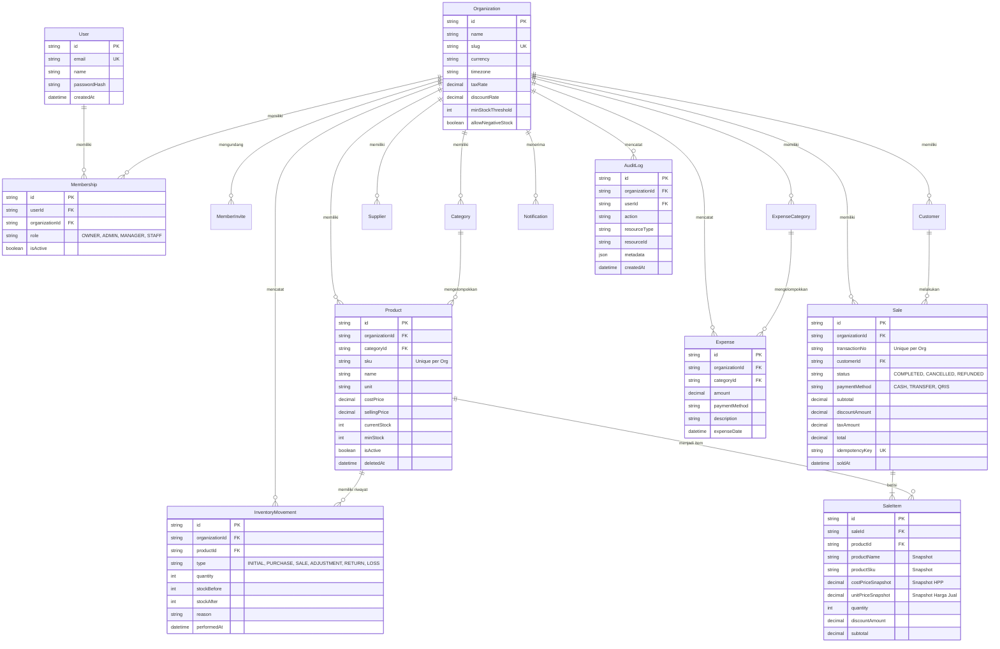

# Entity-Relationship Diagram (ERD) — UMKM Business Assistant

## Visual Diagram (Mermaid)

## Aturan Integritas Data & Relasi:

1. **Multi-Tenancy**: Setiap entitas bisnis memiliki kolom `organizationId` dengan Foreign Key ke tabel `Organization` (`onDelete: Cascade`).
2. **SKU Scope**: SKU unik per organisasi dengan constraint `@@unique([organizationId, sku])`.
3. **No Float for Money**: Seluruh nilai moneter (`costPrice`, `sellingPrice`, `subtotal`, `taxAmount`, `total`, `amount`) menggunakan tipe PostgreSQL `Decimal(15, 2)`.
4. **Historical Price Stability**: Tabel `SaleItem` menyimpan snapshot `costPriceSnapshot` dan `unitPriceSnapshot`. Jika produk di kemudian hari diubah harga modal atau harga jualnya, transaksi lampau dan laba kotor riil tidak akan berubah.
5. **Inventory Immutability**: Tabel `InventoryMovement` tidak memiliki kolom `updatedAt` maupun `deletedAt`. Data riwayat stok tidak dapat dimanipulasi secara diam-diam.
